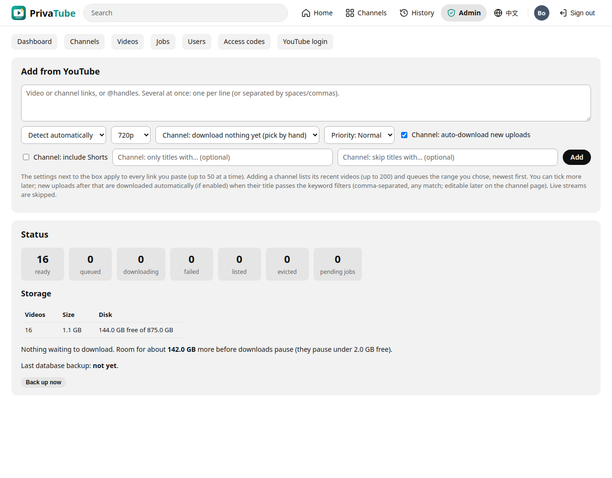

<p align="center">
  
</p>

<h1 align="center">PrivaTube</h1>

<p align="center"><b>🎬 Your videos. 🖥️ Your server. 🔐 Yours to keep.</b></p>

<p align="center">
Bring YouTube videos to people in places where YouTube is blocked or can't be reached.<br>
A self-hosted, invite-only video library on one small server. 🌏
</p>

<p align="center">
  <a href="LICENSE"></a>
  
  
</p>

---

## 💡 Why PrivaTube?

In some countries and regions YouTube is **blocked**, and on some networks it's filtered
or too slow to use. Many people there would still love to watch the lectures, news,
tutorials and family-favourite channels everyone else can see. Some also don't have, or
don't want, a Google account.

PrivaTube lets you bring those videos to them: family, friends or a small community. 🤝

1. 🎯 **You choose** the channels and videos worth sharing.
2. 🖥️ **Your server**, somewhere YouTube *is* reachable, downloads them with
   [yt-dlp](https://github.com/yt-dlp/yt-dlp), along with their subtitles and comments,
   and checks for new uploads.
3. 🍿 **The people you invite** watch them in a clean, fast web player on your own domain.
   They need only a browser: no YouTube, no Google account, no VPN, no app.

🔐 It stays private. There is no public sign-up: viewers get an account or a limited access
code from you. Every video link is signed and expires. Search engines are kept out, and
each viewer's name is shown faintly on the video. Videos also stay watchable after
they're deleted or made private on YouTube.


## ✨ Features

**📚 Library**
- Add channels, single videos or `@handles`, up to 50 links at once.
- For each channel, choose what to fetch first: nothing (you pick videos by hand), the
  latest N videos, or the last N days. New uploads are then downloaded automatically.
- Keyword filters per channel ("only titles with…" / "skip titles with…").
- Quality per channel or per video (360p–1080p; H.264 by default so it plays everywhere).
  Download priority per channel.
- Shorts are optional. Live streams and members-only videos are skipped: when a creator
  also posts a public version, that version is downloaded.
- Top comments are kept and refreshed daily during a video's first month. Subtitles are
  saved in the languages you choose: human-made tracks first, else YouTube's automatic ones.
- Storage planning: the admin dashboard estimates the size of the download queue and the
  room left. Downloads pause before the disk fills up.

**🍿 Watching**
- A fast, server-rendered site that works without a build step and installs as an app
  on phones.
- A custom player: resume where you left off, playback speed, subtitles, keyboard
  shortcuts (`k`/space, `j`/`l`, arrows, `f`, `m`, `c`, `<`/`>`).
- Continue watching, history, search, channel pages and up-next suggestions.
- English and Chinese interface, picked from the browser and switchable.

**👥 People and access**
- Accounts with a username only. Passwords are generated (no weak ones), rotate every six
  months, and each account has a limit on signed-in devices.
- Admins also sign in with a two-factor code (TOTP).
- **Access codes** for guests: limited devices, an expiry date, and optionally only certain
  channels or videos. Viewers can share a single video as a short-lived code.
- Each viewer's name is shown as a faint moving watermark on the video.

**🛡️ Security and operations**
- Every video, thumbnail and picture link is signed, tied to the viewer, and expires.
  nginx checks the signature, so files are never reachable without one.
- Strict Content-Security-Policy (no inline scripts), CSRF protection on every form,
  argon2id password hashes, rate-limited sign-in, and `noindex` everywhere.
- The services run as an unprivileged user in a read-only systemd sandbox.
- When YouTube asks the server to prove it's "not a bot", all YouTube work pauses and
  backs off together. You can upload cookies from a spare Google account in the admin panel.
- yt-dlp updates itself daily. The database is backed up daily (the last 14 copies are
  kept), and a restore script checks a backup before using it.
- Health checks show a red banner in the admin panel and, optionally, send a push
  notification. They cover a full disk, failing downloads, the bot check, expiring
  certificates, broken video delivery and missing backups.

| Sign-in | Admin dashboard |
|---|---|
|  |  |

## 🧰 What you need

- A server running **Debian 12 or 13** (tested; Ubuntu 22.04+ should work too): 1 GB of RAM is enough, and disk space
  depends on how much you keep (720p is roughly 0.5 GB per hour of video).
- A **domain name** pointing at the server (an `A`/`AAAA` record).
- Ports **80** (for the Let's Encrypt certificate) and **443** open in the firewall.
- 📍 A location that works for both sides: **the server must reach YouTube**, and **your
  viewers must reach the server** quickly. A data centre close to your viewers, but
  outside the region that blocks YouTube, is usually best. (Before you rely on it, check
  that your viewers' networks can reach the server's address.)

## 🚀 Install

Point your domain at the server, then run this one line on it (replace the domain and
the admin name):

```bash
curl -fsSL https://raw.githubusercontent.com/Devin0026/privatube/main/deploy/get.sh | sudo APP_HOST=videos.example.com ADMIN=yourname bash
```

It takes about five minutes. At the end it shows your admin password **once**, so write
it down. Then open `https://videos.example.com`, sign in, and scan the two-factor QR code
with an authenticator app. Paste a channel link into **Admin → Add from YouTube** and
you're done. 🎉

<details>
<summary>Prefer to read the code before running it? Install from a checkout instead.</summary>

```bash
git clone https://github.com/Devin0026/privatube.git
cd privatube
sudo APP_HOST=videos.example.com bash ./deploy/install.sh
sudo bash ./deploy/create-admin.sh yourname
```
</details>

The installer is safe to run again: it updates the code and keeps your data and settings.
It sets up:

- nginx and a Let's Encrypt certificate;
- a Python virtual environment in `/opt/privatube`, with ffmpeg, yt-dlp and Deno (which
  yt-dlp needs for YouTube);
- the `privatube-web` and `privatube-worker` services and a daily yt-dlp update;
- automatic security updates.

It only adds its own nginx files, so other sites on the server keep working.

### ⚙️ Options

| Variable | Default | Meaning |
|---|---|---|
| `APP_HOST` | (required) | The site's domain name. |
| `ADMIN` | (none) | One-line install only: create this admin account on the first install. |
| `HTTPS_PORT` | `443` | Port for HTTPS. |
| `CLOUDFLARE` | `0` | Set to `1` if the DNS record is proxied by Cloudflare (orange cloud). nginx then logs the real visitor IPs. Port 80 must still reach the server for the certificate. To use a port other than 443 behind Cloudflare, add an Origin Rule that sends HTTPS to that port, and pick one of the ports Cloudflare proxies (2053, 2083, 2087, 2096, 8443). |

### 🛠️ Settings

Settings live in `/etc/privatube/env` (created from [`deploy/env.example`](deploy/env.example)).
After editing, run `sudo systemctl restart privatube-web privatube-worker`.

| Setting | Default | Meaning |
|---|---|---|
| `PT_DEFAULT_HEIGHT` | `720` | Highest video quality unless a channel or video says otherwise. |
| `PT_SUB_LANGS` | `en` | Subtitle languages to keep, comma-separated (e.g. `en,de`). |
| `PT_TITLE_LANG` | (off) | Also store titles in this language, for search and keyword filters (e.g. `zh-CN`, `ja`). |
| `PT_MIN_FREE_GB` | `2` | Downloads pause while the disk has less free space than this. |
| `PT_MAX_COMMENTS` | `300` | Comments kept per video. |
| `PT_POLL_MINUTES` | `60` | How often channels are checked for new uploads. |
| `PT_MAX_DEVICES` | `2` | Devices signed in at once per account. |
| `PT_PASSWORD_MAX_AGE_DAYS` | `182` | Viewers get a new password after this many days. |
| `PT_BACKUP_HOURS` / `PT_BACKUP_KEEP` | `24` / `14` | Database backup interval and how many to keep. |
| `PT_ALERT_URL` | (off) | Push URL for problems: receives a form POST with `title` and `desp`/`body`. |
| `PT_YTDLP_IPV4` | `1` | Talk to YouTube over IPv4 (it often blocks datacenter IPv6). |

### 🤖 When YouTube asks "Sign in to confirm you're not a bot"

YouTube sometimes blocks servers in data centres. PrivaTube pauses all YouTube work when
this happens (30 minutes, doubling up to 6 hours) instead of retrying again and again.
If the block lasts, upload cookies under **Admin → YouTube login**:

1. Sign in to a spare Google account in a private browser window.
2. Export its cookies.
3. Close the window without signing out.

The page explains each step. `sudo bash ./deploy/check-youtube.sh` shows whether access
works.

## 🗓️ Everyday use

- **Update:** run the same one-line install again (or `git pull` and `install.sh` in a checkout).
- **Accounts:** in **Admin → Users**. New users get a generated password to pass on.
- **Guests:** create an **access code** in **Admin → Access codes**, limited to certain
  channels or videos, a number of devices and an expiry date.
- **Free up space:** in **Admin → Videos**, *Delete file* removes the video file but keeps
  its page, comments and thumbnail. You can download it again later.
- **Logs:** `journalctl -u privatube-worker -f` (downloads) and `journalctl -u privatube-web`.

## 💾 Backups

The database (accounts, channels, history and comments) is backed up every day to
`/var/lib/privatube/backups`. Copy that folder somewhere else from time to time, for
example with a nightly `rsync` to another machine. Video files can always be downloaded
again, so the database is the part that really matters.

To restore a backup (it's checked first; the current database is kept next to it):

```bash
sudo bash ./deploy/restore.sh /var/lib/privatube/backups/privatube-YYYYMMDD-HHMMSS.db.gz
```

## 🏗️ How it works

```
browser ──HTTPS──> nginx ──> /m/...  video files, checked by secure_link (signed, expiring)
                         └─> /...    FastAPI app (pages, player, admin)  ──> SQLite
                                     worker: yt-dlp downloads, channel checks, subtitles,
                                             comments, backups, health checks  (systemd)
```

- **Python 3.11+**, FastAPI with server-rendered Jinja2 templates, and SQLite (WAL mode)
  with a job queue in the database.
- One background worker handles downloads one at a time (fine for a 1 GB server), so jobs
  retry with backoff and their errors stay visible in the admin panel.
- The app signs file links; nginx streams the files itself, including seeking and
  range requests.
- Everything lives in `/var/lib/privatube`: the database, media, backups and cookies.

## 🧑‍💻 Development

```bash
python3 -m venv .venv && .venv/bin/pip install -e ".[dev]"
.venv/bin/pytest                                   # the test suite, no network needed
export PT_DATA_DIR=./data PT_SERVE_MEDIA=1 PT_COOKIE_SECURE=0
.venv/bin/python -m privatube.cli create-user me --admin
.venv/bin/uvicorn privatube.web:app --reload        # http://127.0.0.1:8000
.venv/bin/python -m privatube.worker                # downloads (needs ffmpeg)
```

`PT_SERVE_MEDIA=1` makes the app serve and check media links itself, so you don't need
nginx while developing. See [CONTRIBUTING.md](CONTRIBUTING.md) for the project's rules of
thumb.

## ⚖️ Legal

PrivaTube is an independent project. It is **not affiliated with, endorsed by or connected
to YouTube or Google**.

Downloading videos may be against YouTube's Terms of Service, and copyright law differs
between countries. Archive only what you have the right to keep, for example your own
uploads, Creative Commons videos, or private copies where your local law allows them.
Don't use PrivaTube to republish other people's work. You are responsible for how you
use it.

## 💖 Support PrivaTube

PrivaTube is free and always will be. If it helps you share videos with people you care
about, a small tip keeps it going. Thank you! 🙏

**USDT / USDC / ETH** on Ethereum or any EVM network (Arbitrum, Base, Optimism, Polygon,
BNB Chain):

```
0xdff2E58ae8a2e1A4B47dbA26a042549cF5b21849
```

⭐ Starring the repository, 🐛 reporting bugs and 📣 telling friends help just as much.

## 📄 License

[GNU Affero General Public License v3.0](LICENSE) (AGPL-3.0-or-later). You may use,
change and share PrivaTube freely. If you run a modified version for other people, you
must offer them its source code too.
