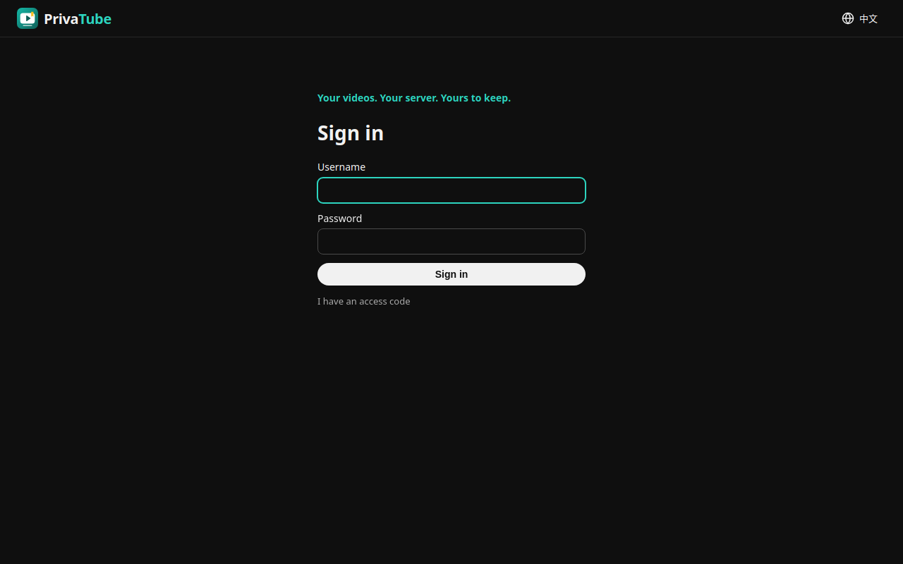

<p align="center">
  
</p>

<h1 align="center">PrivaTube</h1>

<p align="center"><b>🎬 Your videos. 🖥️ Your server. 🔐 Yours to keep.</b></p>

<p align="center">
Bring YouTube videos to people in places where YouTube is blocked or can't be reached.<br>
A self-hosted, invite-only video library on one small server. 🌏
</p>

<p align="center">
  <a href="LICENSE"></a>
  
  
</p>

## 🚀 One-line install

On a **Debian 12/13** server with a domain pointing at it (ports 80 and 443 open):

```bash
curl -fsSL https://raw.githubusercontent.com/Devin0026/privatube/main/deploy/get.sh | sudo APP_HOST=videos.example.com ADMIN=yourname bash
```

About five minutes later it prints your admin password **once**, so write it down. Open
your site, sign in, scan the two-factor QR code, and paste a channel link into
**Admin → Add from YouTube**. 🎉 Run the same line again any time to update.

> 📍 **Pick the server's location carefully.** It must reach YouTube, and your viewers
> must reach it. A data centre near them, but outside the region that blocks YouTube, is
> usually best. 1 GB of RAM is enough; 720p needs about 0.5 GB of disk per hour of video.

<details>
<summary>Prefer to read the code first? Install from a checkout.</summary>

```bash
git clone https://github.com/Devin0026/privatube.git && cd privatube
sudo APP_HOST=videos.example.com bash ./deploy/install.sh
sudo bash ./deploy/create-admin.sh yourname
```

The installer sets up nginx and a Let's Encrypt certificate, ffmpeg, yt-dlp and Deno, the
`privatube-web` and `privatube-worker` services, a daily yt-dlp update and automatic
security updates. It only adds its own nginx files, so other sites on the server keep
working. Options: `HTTPS_PORT` (default 443), and `CLOUDFLARE=1` if the DNS record is
proxied by Cloudflare. To use a port other than 443 behind Cloudflare, add an Origin Rule
that sends HTTPS to it, and pick one Cloudflare proxies (2053, 2083, 2087, 2096 or 8443).
</details>

## 💡 Why PrivaTube?

In some regions YouTube is **blocked**, and on some networks it's too slow to use. People
there still want the lectures, news, tutorials and channels everyone else can watch.

1. 🎯 **You choose** the channels and videos worth sharing.
2. 🖥️ **Your server**, somewhere YouTube *is* reachable, saves them with
   [yt-dlp](https://github.com/yt-dlp/yt-dlp), with subtitles and comments, and checks
   for new uploads.
3. 🍿 **The people you invite** watch in a fast web player on your domain. They need only
   a browser: no YouTube, no Google account, no VPN, no app.

🔐 **It stays private.** There's no public sign-up, every video link is signed and
expires, search engines are kept out, and each viewer's name is faintly watermarked on
the video. Videos stay watchable even after they're deleted from YouTube.


## ✨ Features

- 📚 **Library:** add channels, videos or `@handles`, up to 50 at once. For each channel,
  start with the latest N videos, the last N days, or hand-picked ones; new uploads
  follow automatically. Keyword filters, quality (360p–1080p) and priority are set per
  channel. Members-only videos and live streams are skipped.
- 🍿 **Watching:** resume where you left off, playback speed, subtitles (in the
  languages you choose), keyboard shortcuts, continue watching, history, search. English
  and Chinese interface. Installs as an app on phones.
- 👥 **People:** accounts with generated passwords, a limit on devices per account, and
  two-factor sign-in for admins. **Access codes** for guests, limited by devices, expiry
  date, and channel or video.
- 🛡️ **Safety:** strict Content-Security-Policy, CSRF protection, argon2id password
  hashes, and a sandboxed systemd service.
- 🔧 **Low maintenance:** yt-dlp updates daily, the database is backed up daily, and
  health checks raise an admin banner or a push alert. When YouTube says "not a bot",
  all YouTube work backs off together.

| Sign-in | Admin dashboard |
|---|---|
|  |  |

## 🛠️ Settings

Edit `/etc/privatube/env`, then run `sudo systemctl restart privatube-web privatube-worker`.

| Setting | Default | Meaning |
|---|---|---|
| `PT_DEFAULT_HEIGHT` | `720` | Highest quality unless a channel or video says otherwise. |
| `PT_SUB_LANGS` | `en` | Subtitle languages to keep, e.g. `en,zh`. |
| `PT_TITLE_LANG` | (off) | Also store titles in this language, for search and filters (e.g. `zh-CN`). |
| `PT_MIN_FREE_GB` | `2` | Downloads pause below this much free disk. |
| `PT_MAX_DEVICES` | `2` | Devices signed in at once per account. |
| `PT_BACKUP_KEEP` | `14` | Daily database backups to keep. |
| `PT_ALERT_URL` | (off) | Push URL for problems (form POST with `title`, `desp`/`body`). |

All settings are listed in [`deploy/env.example`](deploy/env.example).

## 🗓️ Everyday use

- 👤 **Viewers:** add accounts in **Admin → Users**, or give guests an access code
  (**Admin → Access codes**).
- 🧹 **Disk space:** in **Admin → Videos**, *Delete file* removes a video but keeps its
  page, comments and thumbnail. You can download it again later.
- 🤖 **"Sign in to confirm you're not a bot":** YouTube sometimes blocks data-centre
  servers. If the block lasts, upload cookies from a spare Google account in
  **Admin → YouTube login** (the page explains how).
- 💾 **Backups:** made daily in `/var/lib/privatube/backups`. Copy them to another
  machine now and then. To restore one:
  `sudo bash ./deploy/restore.sh /var/lib/privatube/backups/<file>.db.gz`
- 📜 **Logs:** `journalctl -u privatube-worker -f`

## 🏗️ How it works

```
browser ─HTTPS─> nginx ─> /m/…  video files (signed, expiring links checked by nginx)
                       └─> /…    FastAPI app (pages, player, admin) ─> SQLite
                                 worker: yt-dlp downloads, channel checks, subtitles,
                                         comments, backups, health checks
```

It's Python 3.11+, FastAPI with server-rendered templates, and SQLite with a job queue in
the database. One worker downloads one video at a time, so it's fine for a 1 GB server.
Everything lives in `/var/lib/privatube`.

## 🧑‍💻 Development

```bash
python3 -m venv .venv && .venv/bin/pip install -e ".[dev]" && .venv/bin/pytest
export PT_DATA_DIR=./data PT_SERVE_MEDIA=1 PT_COOKIE_SECURE=0
.venv/bin/python -m privatube.cli create-user me --admin
.venv/bin/uvicorn privatube.web:app --reload     # http://127.0.0.1:8000
```

Contributions are welcome. See [CONTRIBUTING.md](CONTRIBUTING.md).

## ⚖️ Legal

PrivaTube is an independent project, **not affiliated with YouTube or Google**.
Downloading may be against YouTube's Terms of Service, and copyright law differs between
countries. Keep only what you have the right to keep, don't republish other people's
work, and use it responsibly.

## 💖 Support PrivaTube

PrivaTube is free and always will be. If it helps you share videos with people you care
about, a small tip keeps it going. Thank you! 🙏

<table>
<tr>
<td></td>
<td>
<b>USDT / USDC / ETH</b><br>
Ethereum or any EVM network<br>
(Arbitrum, Base, Optimism, Polygon, BNB Chain)<br><br>
<code>0xdff2E58ae8a2e1A4B47dbA26a042549cF5b21849</code>
</td>
</tr>
</table>

⭐ Starring the repository, 🐛 reporting bugs and 📣 telling friends help just as much.

## 📄 License

Copyright © 2026 Devin0026 and contributors.
[AGPL-3.0](LICENSE): free to use, change and share. If you run a modified version for
other people, offer them its source code too.
